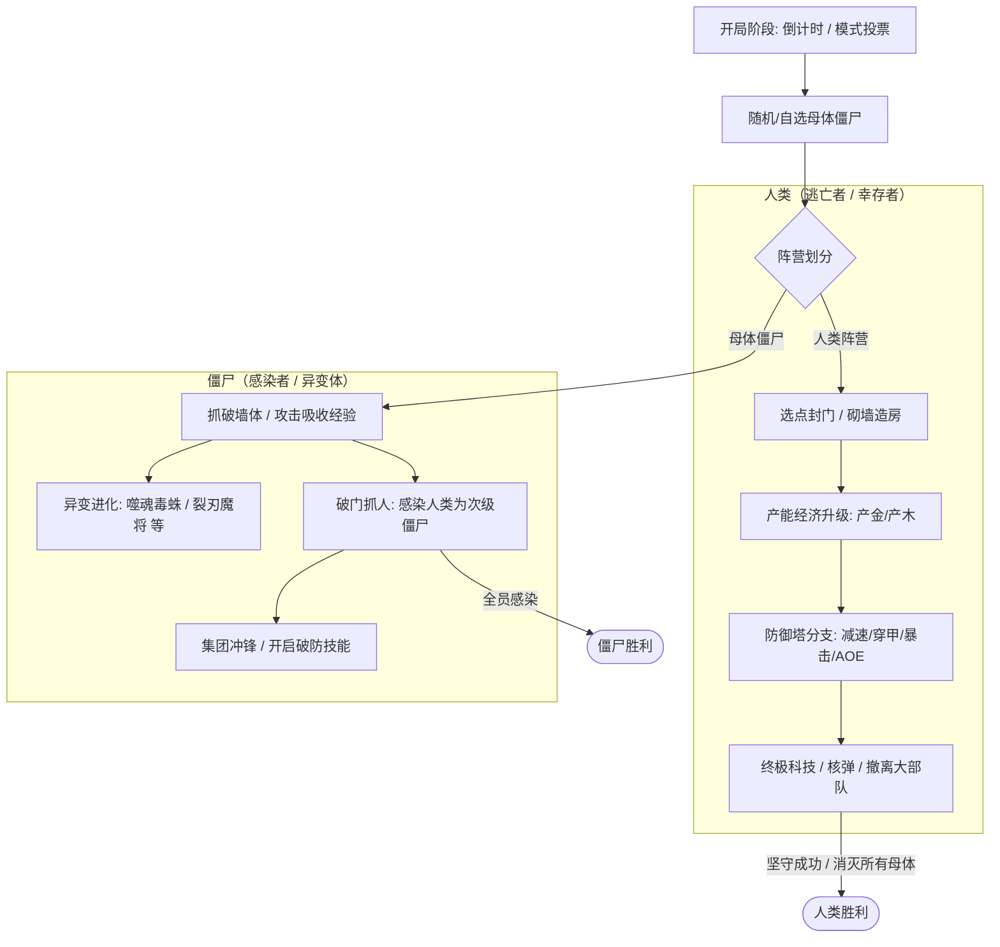
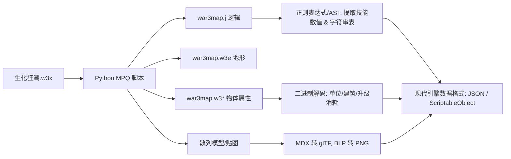

# 《生化狂潮》复刻技术方案与现代化创新设计

本文档针对魔兽争霸3经典非对称对抗/塔防生存地图《生化狂潮》（当前样本：`生化狂潮_迁移版V2.w3x`）制定**复刻实施方案**与**现代化创意扩展方案**。

---

## 一、 地图逆向与核心玩法机制剖析

根据对 `war3map.j` 及二进制数据的初步探测，《生化狂潮》的核心机制为**非对称博弈 + 基地建造塔防 + 生化感染进化**：

- **人类体验**：封路策略、紧凑布局（"农民墙：别塞了，我挤不下了！"）、经济滚雪球、塔防协同、防空防隐身。
- **僵尸体验**：前中期找薄弱点突破、抓单滚雪球、不同异变体技能连招（暴击、吸血、闪烁破墙、毒液消耗）。

---

## 二、 复刻技术方案选型

针对不同目标场景，提供以下 3 种主流复刻路线：

### 方案 A：独立游戏化复刻（推荐首选：Godot 4 或 Unity）
> **目标**：摆脱 War3 引擎限制，制作成 Steam / 独立联机游戏（类似《Youtubers Life》《吸血鬼幸存者》或《Rust/DayZ》的上帝视角版）。

- **引擎推荐**：
  - **Godot 4.3+ (C# / GDScript)**：轻量级、开源无分成、对网格/2D/2.5D/3D 支持优秀，非常适合做房间制联机对抗。
  - **Unity 6 (URP + Netcode for GameObjects / FishNet)**：工业级方案，如果打算使用 3D 模型和炫酷着色器特效，Unity 生态资源最全。
- **架构设计**：
  - **网络方案**：客户端-服务器（Dedicated Server / 房主 Host），严防作弊（War3 时代全图外挂很多，现代 CS 架构可解决）。
  - **网格寻路系统**：采用 2D/3D Grid Tilemap 碰撞与 Flowfield（流场寻路），支持海量僵尸单位低开销寻路与推挤（Avoidance）。
  - **数据驱动**：将提取出来的魔兽数值（建造消耗、升级树、攻击力）转为 JSON / ScriptableObject 驱动。

### 方案 B：纯 Web 轻量级复刻（免下载点击即玩：TypeScript + WebGL / PixiJS / Three.js）
> **目标**：H5 小游戏、微信小游戏、网页端即开即玩开房间。

- **技术栈**：
  - **前端渲染**：`Pixi.js`（2.5D 像素/纸片风）或 `Three.js` / `Babylon.js`（复用原版 MDX 模型）。
  - **后端联机**：`Node.js` + `Colyseus` / `Geckos.io` (WebRTC 数据通道，超低延迟)。
- **优势**：极度利于社交裂变与开黑，开房间发个链接就能直接玩。

### 方案 C：原生地图生态重构（基于新一代 Warcraft III / Warsmash）
> **目标**：继续在魔兽圈子或开源魔兽引擎内发布。
- 使用 `w3x2lni` 将 `.w3x` 解成明文代码工程。
- 用现代 Lua 替代古老的 JASS 脚本，剔除过期的网易平台私有 DzAPI。

---

## 三、 数据与资产提取流水线 (Pipeline)

当前我们已经用 Python 和 `uv` 搭建了基础工程，整体解包步骤如下：

1. **资源爆破与恢复**：
   - 提取 `war3map.j` 中所有含路径字符串（如 `war3mapImported\*.mdx`），反向导出 MPQ 内部被隐藏的模型与音频。
2. **格式转换**：
   - 模型：`MDX` $\rightarrow$ `glTF 2.0`（现代引擎通用）。
   - 贴图：`BLP` $\rightarrow$ `PNG` / `WebP`。
3. **数值剥离**：
   - 将墙体血量、升级造价、防御塔射程、僵尸移速护甲等导出为 Excel/JSON 配置文件。

---

## 四、 现代化创新创意与玩法升级

如果仅仅做像素级 1:1 照搬，容易陷入审美疲劳。结合近几年热门的生存、肉鸽（Roguelike）与非对称竞技设计，推荐以下创新方向：

### 创意 1：Roguelike 异变与科技卡牌（构筑乐趣）
- **传统痛点**：传统生化狂潮每局套路较固定（无脑升级固定等级的墙和激光塔）。
- **创新机制**：
  - **人类端**：每当建造主基地或坚持满 X 分钟，可进行“**三选一科技芯片**”（例如：*《穿透弹头》防御塔穿透 +1；《纳米维修》墙体每秒回血 3%；《房产大亨》金币产能 +30% 但墙体易碎*）。
  - **僵尸端**：母体僵尸每击杀或感染一定数量人类，获得“**基因进化点**”（例如：*自爆毒囊、潜地突进、腐蚀粘液破护甲、临时群体霸体*），打破人类死守死胡同的僵局。

### 创意 2：地形动态破坏与多维度防御
- **传统痛点**：地图地形是固定的死路。
- **创新机制**：
  - 引入**环境物理破坏**：僵尸可以挖掘薄弱泥墙开辟新进攻路线；
  - 人类可以**布置陷阱**：电网、弹射跳板、感应地雷、临时阻断隔离门；
  - 增加**昼夜/视线系统（Fog of War）**：夜晚僵尸移速提升并获得隐蔽视野，人类需消耗电力维持探照灯照明。

### 创意 3：多阵营与深层社交（狼人杀元素）
- **潜伏感染者机制（可选模式）**：
  - 开局不立刻公布谁是母体。所有人正常以人类身份采矿发展，但其中 1~2 人是“**潜伏宿主**”，在特定时间内可自由选择在暗处突变，或者暗中切断某区域的人类电源、给防线开后门，大幅增加心理博弈与开黑节目效果。

### 创意 4：PVE / 单人肉鸽无尽割草模式
- 除了 8~12 人的非对称 PVP，补充一个**单人/双人合作 PVE 模式**：
  - 玩家防守四面八方涌来的成千上万波次潮水般丧尸（结合《亿万僵尸》(They Are Billions) 与幸存者割草体验），极大降低组队门槛。

---

## 五、 推荐的落地实施路线图

| 阶段 | 目标 | 交付物 |
| :--- | :--- | :--- |
| **Phase 1** | **资产全量抽取与数值还原** | 编写 Python 脚本导出所有模型、贴图、音频、单位数值表（JSON/Excel）。 |
| **Phase 2** | **原型框架搭建 (Core Prototype)** | 在选定引擎（如 Godot/Unity）中实现：网格放置建造、寻路、攻击与伤害结算。 |
| **Phase 3** | **核心对抗循环实现** | 实现母体随机选择、击破墙体、感染机制、胜负判定与联机同步。 |
| **Phase 4** | **美术替换与现代化升级** | 引入动态光照、科技树三选一卡牌、打击音效与现代 UI。 |
