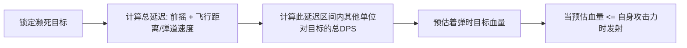

# 战斗操控与输入缓冲系统设计规范 (Input Buffer & Prediction)

在复刻《生化狂潮》或类似 RTS/MOBA 对抗游戏时，若要达到“操作极致流畅、不漏刀、预判走位放技能”的打击手感，必须脱离魔兽原生古老指令机制，建立现代动作游戏标准的**输入缓冲队列（Input Buffer）**与**运动预测（Movement Prediction）**。

---

## 一、 输入缓冲（Input Buffer）机制

### 1. 痛点：为什么原生魔兽或粗糙复刻会感觉“卡手/吞键”？
在传统魔兽争霸3引擎中，单位攻击与施法具有明确的周期划分：

```
[----- 前摇 (Damage Point) -----] -> 判定点 -> [----- 后摇 (Backswing) -----]
                                             ^
                                         此时造成伤害
```

- **无缓冲设计**：玩家在“后摇”期间点击移动或放技能，指令直接被引擎丢弃，玩家就会明显感到“我明明按了，为什么技能没放出来？”。
- **强制后摇设计**：玩家下达下一个指令必须完全等待后摇播完，攻击动作僵硬。

### 2. 现代输入缓冲窗口（Buffer Window）架构

```mermaid
flowchart TD
    Input[玩家按键/点击] --> CheckState{当前是否在动作不可打断期?}
    CheckState -->|否: 处于空闲或后摇| Exec[立即执行新动作 + 取消后摇]
    CheckState -->|是: 处于前摇中| BufferCheck{距判定点时间 <= 缓冲窗口(150ms)?}
    BufferCheck -->|是| PushBuffer[存入输入缓冲区: BufferedCommand]
    BufferCheck -->|否| Discard[丢弃过早输入]
    
    ActionFinish[前摇判定结束 / 动作过渡] --> CheckBuffered{缓冲区有待决指令?}
    CheckBuffered -->|有| PopExec[零延迟触发缓冲指令]
    CheckBuffered -->|无| Idle[播放后摇或回到站立]
```

#### 关键参数配置表：
| 参数名 | 推荐数值 | 说明 |
| :--- | :--- | :--- |
| `BufferWindow` | 120ms ~ 180ms | 接收提前输入的时域窗口，太短会吞键，太长会误操作 |
| `CanCancelBackswing` | true | 伤害/施法生效的一瞬间允许移动取消剩余后摇 |
| `CommandQueueMax` | 1 ~ 2 | 缓冲区深度（通常保留最新的 1 个移动或技能指令） |

---

## 二、 极限补刀（不漏刀）判定逻辑

在防守方对抗僵尸、补刀收资源时，实现“不漏刀”体验有两种应用场景：

### 1. 玩家端的手感补偿（容错机制）
- **判定阈值宽容度**：如果小兵/僵尸在受到玩家攻击着弹前 50ms 内被己方箭塔或其它小兵击杀，只要玩家弹道已经处于半空中，判定系统判定补刀收益归属于玩家。
- **斩杀血线高亮（UI 辅助）**：当目标当前生命值低于玩家单次普攻税后伤害时，血条变为闪烁红光或斩杀标记。

### 2. AI 决策端的零误差补刀算法



- **弹道到达时间计算**：
  $$T_{impact} = T_{windup} + \frac{\|\vec{P}_{target} - \vec{P}_{self}\|}{V_{projectile}}$$
- **击杀临界点**：
  $$HP_{target} - (DPS_{incoming} \times T_{impact}) \le Damage_{self}$$

---

## 三、 预判走位使用技能（Linear Prediction & Aiming）

对于非指向性技能（如僵尸的跳扑、人类的穿甲炮弹、减速毒液）：

### 1. 一阶线性截击算法（Linear Interception）
设目标当前位置为 $\vec{P}_t$，当前速度矢量为 $\vec{V}_t$；释放者位置为 $\vec{P}_0$，技能投射物速度为 $S_{proj}$，施法前摇延迟为 $T_{cast}$：

$$(\vec{P}_t + \vec{V}_t \cdot (t + T_{cast}) - \vec{P}_0)^2 = (S_{proj} \cdot t)^2$$

通过解该一元二次方程，求出最小正实数根 $t$，即可得到瞄准发射的世界坐标：
$$\vec{P}_{aim} = \vec{P}_t + \vec{V}_t \cdot (t + T_{cast})$$

### 2. 避免假动作（走位抖动识别）
- 如果目标在连续 0.3 秒内频繁变换方向（速度夹角 $> 90^\circ$），说明在进行蛇皮走位。
- 此时算法降低一阶前瞻权重，朝**转向中心点**或**目标碰撞体几何中心**覆盖释放范围伤害（AOE）。
